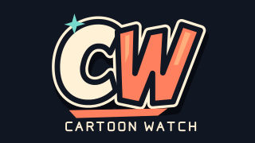

# Cartoon Watch



A remote-friendly WCO catalog with local search, My List, episode browsing, and automatic matching playback fallbacks through AniWave, KissAnime, and HDToday.

The main catalog contains **16,167 unique public WCO links** from the November 17, 2026 snapshot. Android imports it into SQLite and renders 60 titles per page. Movies, cartoons, anime, and OVA are searchable together; episode lists and playback remain live.

## 1. Choose your TV platform

| Platform | Client | Development access |
| --- | --- | --- |
| Compatible Fire OS, Android TV, Google TV | `app/` | Android API 23+, Developer Options, ADB debugging, and TV authorization |
| Roku | [Roku](clients/roku/README.md) | Roku Developer Mode and development installer |
| LG webOS | [LG](clients/lg/README.md) | LG Developer Mode app and webOS CLI |
| Samsung Tizen | [Samsung](clients/samsung/README.md) | TV Developer Mode, Tizen Studio/SDB, and Samsung certificate |

The Android app embeds provider players. Roku/LG/Samsung use native playback through a **computer companion on the same LAN**. Their streams must be compatible with the actual device's codecs and player. The Android/Fire TV path has physical-device verification; other clients have the platform-specific desktop/interpreter/mock checks described in their READMEs. They have not been verified on physical Roku, LG, or Samsung hardware.

### Fire OS, Android TV, and Google TV: enable ADB first

Enable **Developer Options and ADB debugging**, then accept the computer's authorization popup on the TV.

- **Fire OS:** Settings → My Fire TV or Device & Software → About. If Developer Options is hidden, select the device name seven times. Return to Developer Options → ADB Debugging. Find the current address under About → Network. [Amazon instructions](https://developer.amazon.com/docs/fire-tv/connecting-adb-to-device.html)
- **Android TV/Google TV:** Settings → System or Device Preferences → About → Android TV OS build/Build. Select it seven times, then enable USB or Wireless debugging in Developer Options. Menu names vary by manufacturer. [Android TV instructions](https://developer.android.com/training/tv/get-started/create)
- Wireless debugging can require `adb pair ADDRESS:PAIRING_PORT`, followed by connection to a different displayed port. Use the values on your TV; do not assume every TV uses port 5555. [Wireless debugging](https://developer.android.com/tools/adb#connect-to-a-device-over-wi-fi)

No Google Play services are required. The APK does not run on Vega OS, Roku, webOS, or Tizen; use the corresponding separate client where available.

### Roku, LG, and Samsung: use their own developer access

These platforms do **not** use Android ADB. Follow the [Roku](clients/roku/README.md), [LG](clients/lg/README.md), or [Samsung](clients/samsung/README.md) setup instructions. LG requires its Developer Mode app/account and displayed development key. Samsung requires a device-authorized signing certificate. Keep passwords, keys, and certificates local.

## 2. Clone and build Android

Install Python 3.10+ and a full JDK 17+ (Java 22 is locally tested), then:

```sh
git clone https://github.com/Kadamitas/cartoon-watch.git
cd cartoon-watch
python build.py
```

Use `python3` if that is your system's Python command. The builder supports official SDK packages for Windows, macOS, and x86-64 Linux. Windows is the locally exercised host path; macOS needs a compatible SDK native runtime for its architecture.

Checksum-verified SDK 35 tools, jsoup, and AndroidX WebKit are cached in `work/`. The builder aligns, signs, and verifies `outputs/Cartoon-Watch.apk`. Select an existing SDK with `--sdk-root PATH`, `ANDROID_SDK_ROOT`, or `ANDROID_HOME`. `python build.py --tools-only` prepares dependencies without compiling.

Windows users can also run `powershell -ExecutionPolicy Bypass -File .\build.ps1`.

## 3. Inspect and install Android

```sh
python install.py --inspect --device YOUR_TV_ADDRESS:CONNECT_PORT
python install.py --device YOUR_TV_ADDRESS:CONNECT_PORT --no-build
```

If exactly one intended authorized device is connected, `--device` can be omitted. The installer checks the actual model, API level, ABI, display, density, and WebView. It does not scan the LAN or select among multiple TVs. If authorization is missing, approve the TV's prompt and rerun. Omit `--no-build` to build before installation.

A fresh clone creates its own local development signing key. Keep `work/CartoonWatch-debug.keystore` for updates on that installation. A different developer's or fresh CI key cannot update an APK signed by another key; the installer never uninstalls it or erases data automatically.

## 4. Run Roku, LG, or Samsung

Install Node 22+, Python 3.10+, and a JDK, then start the computer companion:

```sh
cd companion
npm install
npm run setup
npm start
```

Keep it running and enter its printed **TV service address** in the client. The default port is 8765. Use the computer's LAN address, not `localhost` on the TV. Allow access only on your intended private network; do not expose the companion or developer installers publicly.

From the repository root:

- **Roku:** `python clients/roku/build.py` creates `outputs/Cartoon-Watch-Roku.zip`. Install through the TV's development installer. [Full setup](clients/roku/README.md)
- **LG/Samsung:** `python clients/webtv/package.py` stages both clients. Packaging and deployment require the respective LG CLI or Tizen SDK/certificate. [Shared client](clients/webtv/README.md), [LG setup](clients/lg/README.md), [Samsung setup](clients/samsung/README.md)

## Codex, Claude, and voice

Open the cloned folder in Codex and ask it to set up Cartoon Watch on your TV; [AGENTS.md](AGENTS.md) defines the workflow. [CLAUDE.md](CLAUDE.md) directs Claude Code to the same instructions. Your friend must identify their TV platform, enable its developer access, and approve their own pairing/authorization prompts.

Native media controls and supported voice-keyboard entry are preserved. Samsung's optional in-app VoiceInteraction support is runtime-detected. Voice playback transport depends on the platform's routing; global assistant catalog search is not automatically registered. No separate Amazon Developer account, custom Alexa skill, cloud bridge, tunnel, hosting plan, or subscription is required. The companion runs locally on your private LAN.

## Controls and maintenance

Arrows/Select browse; Back returns. During Android playback, **Select pauses or resumes** when the toolbar is closed and the manual cursor is off. A focused center Pause/Resume button appears when playback starts and when controls are shown. **Menu** opens the toolbar. The manual cursor starts off; enable it from Menu when you need a site-specific control. **Skip intro** uses the selected player's actual control or valid timing data, including nested players; no fixed duration is guessed. Native-client remote controls are documented per platform.

The header stays visible while the catalog scrolls, with space around focused controls. Layout and safe insets follow the actual viewport and resize automatically; no TV picture-setting change is required.

Where the site exposes compatible player controls, Cartoon Watch selects its highest offered rendition. Quality depends on the source and supported codecs; UHD requires a real 2160p rendition. The decoded video size is reported from the actual player. PC quality checks passed against supported player interfaces; a live Naruto episode 3 source offered only an 800p, 1056×800 rendition, not UHD.

If WCO fails or stalls, matching fallback playback is attempted automatically. Matching includes the title, known release year, season, and episode; ambiguous matches are rejected. Known ad hosts, popups, redirects, and identified promotional interruptions are blocked where the platform supports it. Captions, fullscreen, skip data, resume, native codec compatibility, and source availability vary.

Use `python tools/refresh_catalog.py` to refresh the public WCO title lists. Keep imports streaming, pages bounded, and code comment-free. Preserve [dependency notices](app/src/main/assets/NOTICE.txt). Never commit generated SDKs, signing keys, ADB credentials, device-specific private data, or local configuration. The repository contains metadata and code, not video files.

## Covers and episode thumbnails

Series keep their own cover artwork. The bundled URL-only artwork snapshot contains confidently matched covers for **6,874 series and 1,329 movies** from TVmaze and anime-offline-database. Missing covers can be looked up on demand; unavailable or ambiguous matches retain the CW placeholder. The matching keeps known release years distinct and does not guess among remakes. [Artwork sources and licenses](app/src/main/assets/ARTWORK-NOTICE.txt)

No cover images are bundled. Their compressed URL/credit metadata adds about **145 KiB** to the catalog. Native Android cover caching is limited to 8 MiB/256 files, with images at most 240×360 pixels and JPEG quality 65; common source URLs already request roughly 160×225 or 210×295 pixels.

On supported players, watched episode thumbnails show a small frame captured when pausing or leaving playback normally. Each episode keeps one private thumbnail; the series cover stays separate. Android frames preserve the video aspect ratio within 160×90 pixels at JPEG quality 55, with a 1 MiB/64-frame cache. Capture uses the app's visible SurfaceView/TextureView video layer when available, with a Window fallback. HTML5 LG/Samsung players use 192×108 frames within a private 1 MiB limit. Missing frames, unsupported capture, or abrupt termination fall back to the series cover. Samsung AVPlay and Roku use the cover fallback. No captured frame is uploaded, bundled, or committed.

**Clear history** also clears private episode thumbnails while preserving My List and static cover artwork. These limits keep image storage bounded. On the tested Fire TV, pause and a normal Home exit saved an actual 119x90 video frame (3.3 KB in the pause test). Resuming invalidated the old frame; a forced process stop then correctly fell back to the series cover after restart. Other TV hardware and native codecs still need device verification.

To rebuild artwork URLs on a development computer, run `python tools/enrich_artwork.py`. It caches source metadata under `work/`, uses small image URLs, rejects ambiguous matches, preserves WCO catalog identity, and enforces a 250 KiB compressed metadata budget. The first run downloads metadata, not cover files; it requires no account or API key. `--refresh` refreshes source metadata, while `--anime PATH` and `--tvmaze PATH` reuse existing JSON inputs. `python tools/enrich_artwork.py --check` checks the current artwork without network requests. Catalog refresh preserves existing cover URLs and all attribution fields; run enrichment again to add newly matchable titles.

Earlier physical Fire TV checks passed on Android API 30/Amazon WebView 142: the 16,167-title catalog, Naruto episode 3 playback after a controlled WCO failure, OS media-session pause/play and ten-second seeking, source-button intro skipping, and local search-intent filtering. Spoken assistant commands were not tested. Roku compiled and passed interpreter checks; LG/Samsung passed desktop and SDK-mock checks only.

To check the shared UI after installing the companion's dependencies/browser, run `node tests/ui.cjs` from the repository root. It validates paging, filters, episode payloads, focus, and stale-response handling with the real catalog snapshot and a captured detail fixture. It does not claim live playback. `python tools/refresh_catalog.py --check` validates the bundled snapshot without network requests. Client READMEs describe their platform checks.

Additional PC checks: `node tests/header-layout.cjs` covers responsive bounds, focus, scrolling and resizing from 640×360 through 3840×2160; `node tests/artwork-ui.cjs` covers private episode frames, static covers, clearing history and stale responses; `node tests/quality.cjs` covers actual offered-quality selection with player fixtures. These checks do not prove physical-TV capture or UHD availability.

The current Fire TV build also passed Select-to-pause/resume with the highlighted center control, private-frame cleanup through Clear history, and the scrolled-header focus regression check. The tested Naruto server offered only 800p (1056x800), which was selected and decoded normally; this is not a physical UHD playback test.
